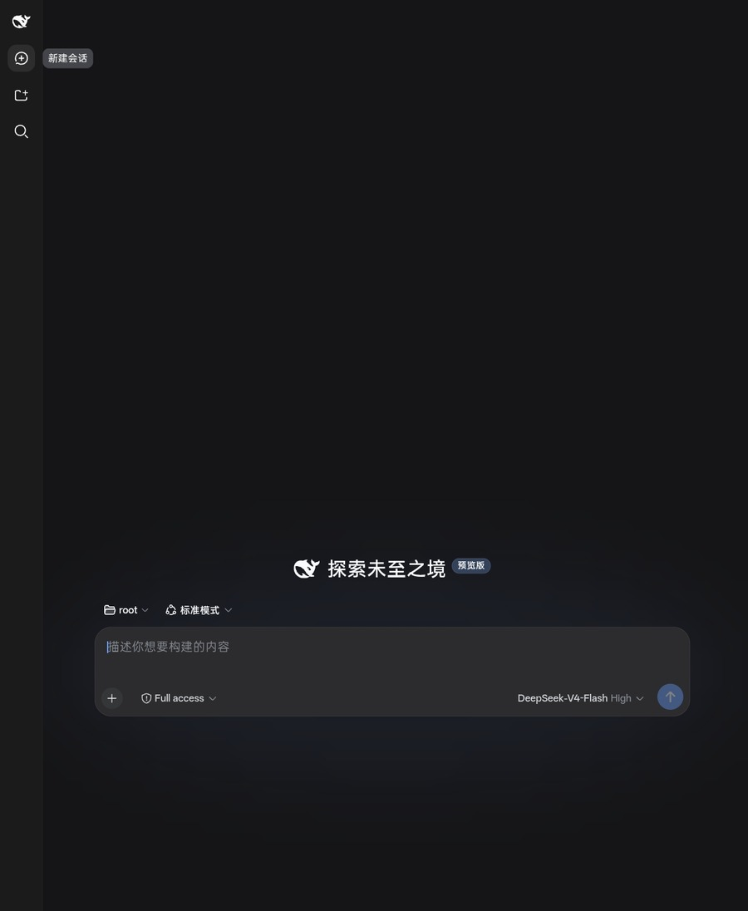
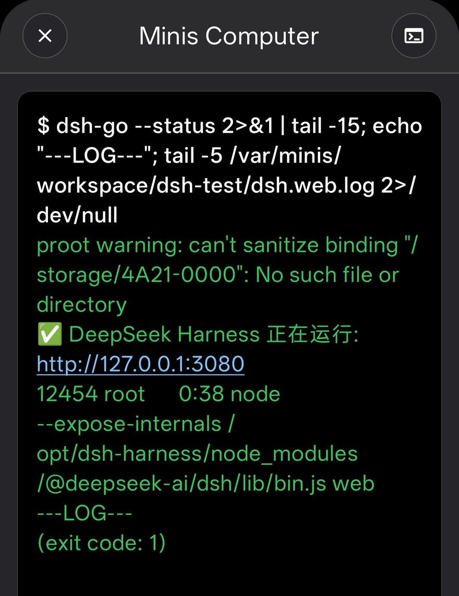

# Run a Full Agent Harness (DeepSeek Harness) Inside Minis — With Your Phone's Files as Its Workspace

> **By @maple564 · Oct 22, 2026** · [Setup scripts & troubleshooting](https://github.com/maple564/dsh-on-android)

### Pain Point

Minis gives you an Alpine sandbox, but if you want a *different* agent — a second opinion, a different model stack, or a browser-based harness UI — you normally need a laptop, a VPS, or SSH into something that isn't your phone.

There is a second, sharper problem: a desktop agent can't touch your phone's files. Getting a generated PPTX/PDF back to the phone means WeChat forwarding, cloud sync, or a USB cable.

### What It Does

Installs **DeepSeek Harness (`dsh web`)** inside Minis' own Alpine sandbox, serves its web UI on `127.0.0.1:3080` (open it in Chrome), and — the point — **registers a Minis mount path as the harness workspace**, so the agent reads and writes your phone's `Documents` / `Download` directly.

- Output lands in `Documents/dsh-workspace/` → open it immediately in a file manager, WPS or WeChat. No transfer step.
- Reverse direction works too: drop a `.docx`, a timetable screenshot or an invoice PDF into `Documents` and let the harness read, edit and re-export it.
- Inference uses your own API key; files never leave the device.
- Runs entirely on the phone — no laptop, no SSH, no VPS.

This is the workflow that makes "an agent on a phone" different from "an agent on a laptop": the agent sits next to your files instead of behind a sync layer.

### How to Use

1. **Open Minis** and start any conversation (the agent needs the shell).
2. **Install the harness** — let the agent run the one-command installer:

```
Install DeepSeek Harness in this sandbox the way described in
https://github.com/maple564/dsh-on-android — run its install.sh,
then verify `dsh --version` and start the web UI with `dsh-go`.
```

   The installer handles the four musl-specific failures that otherwise cost days: glibc-prebuilt `node-pty`, `--expose-internals` being rejected inside `NODE_OPTIONS`, `DSH_PERMISSION_MODE` being a bootstrap-only variable, and the missing sandbox backend in containers.

3. **Mount the workspace** so the harness can see phone files:

```
Register /var/minis/mounts/Documents/dsh-workspace as a workspace in
~/.dsh/storages/workspace.json, restart the harness, and confirm a file
written in that workspace shows up in Documents.
```

4. **Open** `http://127.0.0.1:3080` in Chrome, pick `dsh-workspace`, and work.

### Example Prompt

```
Take the 实践报告.docx in my Documents folder, tighten the wording,
and export a clean PDF back into Documents/dsh-workspace.
```

Or, for the file-visibility sanity check:

```
Write hello.txt into the current workspace, then tell me the absolute
path so I can find it from the phone's file manager.
```

### Expected Output

- `dsh --version` → `0.1.0-rc.x`, web UI reachable at `127.0.0.1:3080` (HTTP 200)
- Files written by the harness appear in `Documents/dsh-workspace/` and open in phone apps
- First install takes 10–25 minutes on a phone CPU (≈800 MB of deps + a `node-pty` recompile)

### Requirements

- [ ] Android 10+ (verified on Android 16 / aarch64)
- [ ] Minis app with the Linux sandbox available
- [ ] A DeepSeek API key (or any OpenAI-compatible endpoint, per harness config)
- [ ] ~800 MB free disk, and patience for the first `npm install`

### Tips & Variations

- **Don't use `/root` as the workspace.** Under PRoot, writes there hit `Operation not permitted`, and the phone can't see the files anyway. Always point the workspace at a `/var/minis/mounts/...` path.
- **Never expose port 3080 publicly.** The harness runs with `DSH_PERMISSION_MODE=danger-full-access`, which means shell access without per-command approval.
- **Process lifetime is tied to the app.** Kill Minis and the harness dies with it — treat it as "open when needed", or run long tasks in small steps.
- **Variation**: use the same mount trick with any other self-hosted browser UI (Gradio, Jupyter, a local RAG app) — the harness is just the first one worth running this way.

---

## 📸 Screenshots

Verified on Android 16, Chrome at `http://127.0.0.1:3080` — no mock-ups.

<p align="center">


</p>

Left: workspace screen, model shown as `DeepSeek-V4-Flash`. Right: a real session — chat/trace views, one artefact produced, 4 tasks done, 31 steps.

<p align="center">

</p>

`dsh-go --status` in the Minis shell — the process line reads `node --expose-internals /opt/dsh-harness/.../bin.js web`, which is the fix for the most confusing of the four setup failures.

More detail, and the mount script, in https://github.com/maple564/dsh-on-android

---

**Last Verified:** 2026-10-22
**Category:** Developer Tools
**Contributor:** [@maple564](https://github.com/maple564)
