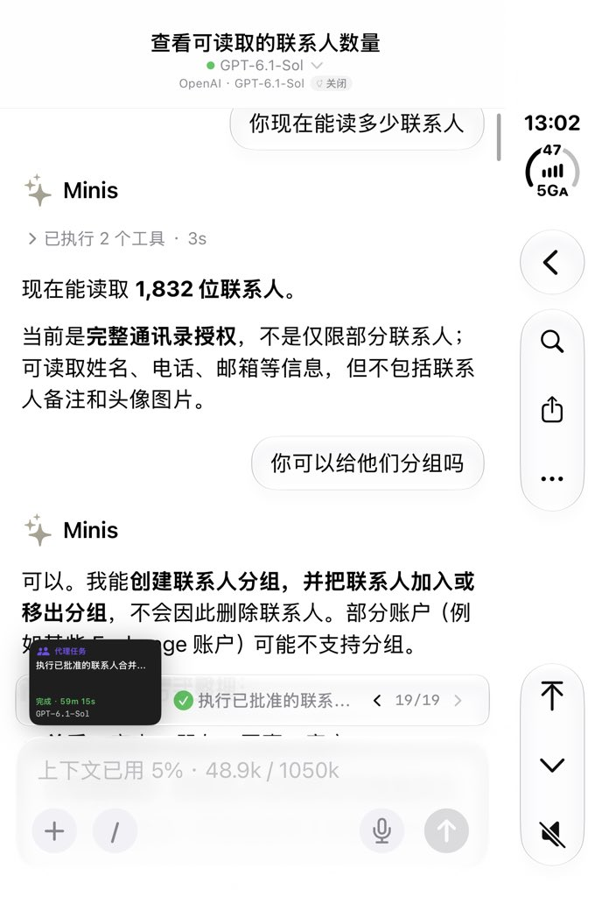
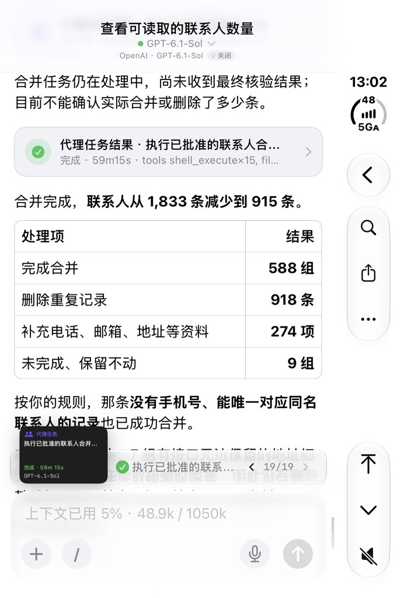
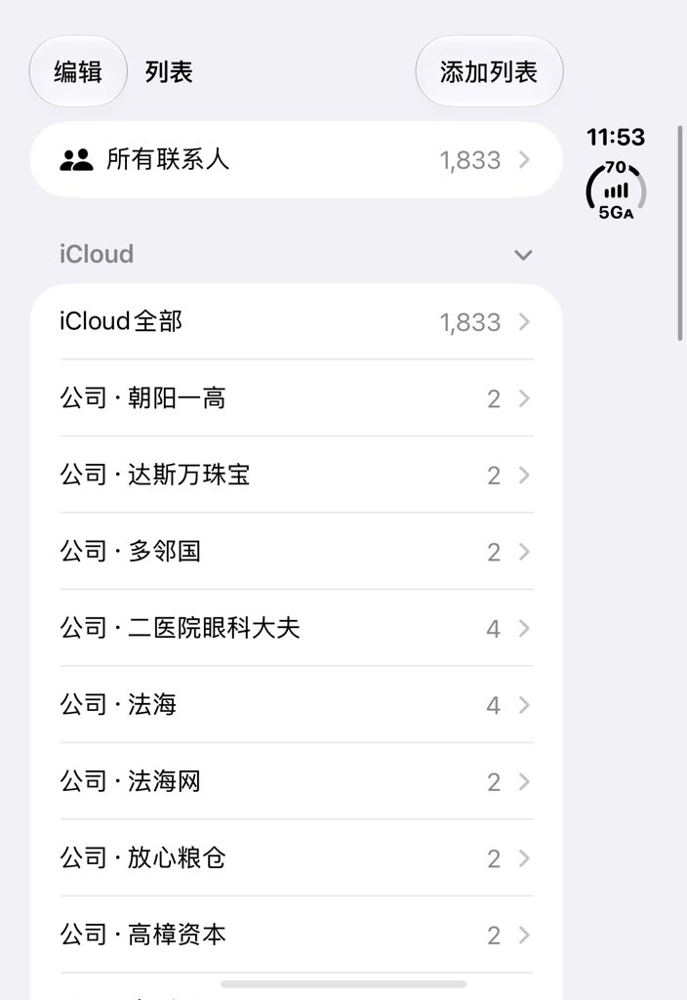

# 十几年的通讯录，一次整理干净：合并重复联系人并自动分组

**Clean Up a Decade-Old Address Book: Merge Duplicates and Auto-Group Contacts**

> 💬 *From [@sunbelife](https://x.com/sunbelife/status/2124731346245570760) · 2026-11-23*

---

## 🎯 痛点 / Pain Point

**中文：** 用了十几年的 iOS 通讯录像地窖一样：同一个人存了好几条、信息散落在不同记录里、没有分组。想整理，但既没动力也没精力，一条条手动合并根本做不完。

**English:** After more than a decade, an iOS address book turns into a cellar: the same person saved several times, details scattered across records, no groups at all. You want to tidy it up, but merging more than a thousand contacts by hand is never going to happen.

---

## 💡 做了什么 / What It Does

**中文：** 授权 Minis 访问完整通讯录后，用自然语言告诉它整理规则：把重复的联系人合并，再按名字和备注加上分组。Minis 先确认可读取的联系人数量，再确认自己能创建分组、把联系人加入或移出分组（不会因此删除联系人），然后把合并任务交给后台代理任务执行。

作者实测（GPT-6.1-Sol 模型，任务耗时约 59 分钟）：

- 联系人从 **1,833 条减少到 915 条**
- 完成合并 **588 组**，删除重复记录 **918 条**
- 补充电话、邮箱、地址等资料 **274 项**
- 有 **9 组**未能完成，保持原样不动
- 合并后，通讯录里出现了按「公司 · 某某」命名的分组列表

作者原话：「十几年的通讯录第一次这么干净。」

**English:** After granting Minis full access to your contacts, you describe the rules in plain language: merge duplicate contacts, then add groups based on names and notes. Minis first checks how many contacts it can read, confirms it can create groups and add or remove contacts from them (without deleting anyone), and then hands the merge job to a background agent task.

Author's real run (GPT-6.1-Sol model, about 59 minutes):

- Contacts went from **1,833 down to 915**
- **588 groups** of duplicates merged, **918 duplicate records** removed
- **274 items** of phone, email and address details carried over into the merged contacts
- **9 groups** could not be completed and were left untouched
- Afterwards the Contacts app shows lists named like "公司 · …" (company-based groups)

In the author's words: "For the first time in over a decade, my address book is this clean."

---

## 🛠 所用技能 / Skills Used

| Skill | Purpose |
|-------|---------|
| Built-in (contacts access) | 读取联系人、创建分组 / Read contacts, create groups |
| Built-in (agent task + `shell_execute`) | 后台代理任务执行批量合并（截图显示调用 shell_execute×15）/ Run the batch merge as a background agent task (screenshot shows 15 shell_execute calls) |

---

## 💬 示例 Prompt / Example Prompt

以下是作者在对话中实际问的两句话，合并规则是作者另外口述的（推文未公开原文）：

The two questions below are what the author actually asked in the screenshots; the merge rules were given separately and the original wording was not published:

**中文：**
```
你现在能读多少联系人
```
```
你可以给他们分组吗
```
```
帮我把联系人合并，按照名字和备注加上分组
```

**English:**
```
How many contacts can you read right now?
```
```
Can you put them into groups?
```
```
Merge my duplicate contacts and add groups based on names and notes.
```

---

## 📸 截图 / Screenshots







*📷 Shared by [@sunbelife](https://x.com/sunbelife/status/2124731346245570760) · 2026-11-23*

---

## ⚙️ 配置要求 / Requirements

- [ ] 授予 Minis 完整的通讯录访问权限（仅限部分联系人时只能处理授权范围内的记录）
- [ ] 通讯录账户需支持分组（部分账户，例如 Exchange，可能不支持）
- [ ] 建议先备份通讯录（导出 vCard），再开始批量合并

---

## 💡 Tips

**中文：**
- 先让 Minis 说出可读取的联系人数量和权限范围，再下指令，避免授权不全
- 合并规则尽量写具体，例如「没有手机号、但能唯一对应同名联系人的记录也一并合并」，作者的任务就是按这类规则处理的
- 合并和删除不可轻易撤销，建议先导出 vCard 备份；任务结束后留意「未完成、保留不动」的那几组，手动检查
- 注意：据截图中 Minis 的说明，它可读取姓名、电话、邮箱等信息，但不包括联系人备注和头像图片

**English:**
- Ask Minis how many contacts it can read and with what permission before you start, so you know the access is complete
- Be specific with merge rules, e.g. "also merge records with no phone number if they match exactly one same-name contact" — the author's run followed rules like this
- Merging and deleting are hard to undo, so export a vCard backup first; after the task, check the groups it reported as "not completed, left untouched"
- Note: per Minis's own reply in the screenshot, it can read names, phones and emails, but not contact notes or photos

---

## 👤 贡献者 / Contributor

来自 X / From X: [@sunbelife](https://x.com/sunbelife/status/2124731346245570760)

---

## 📅 Last Verified

2026-11-23
